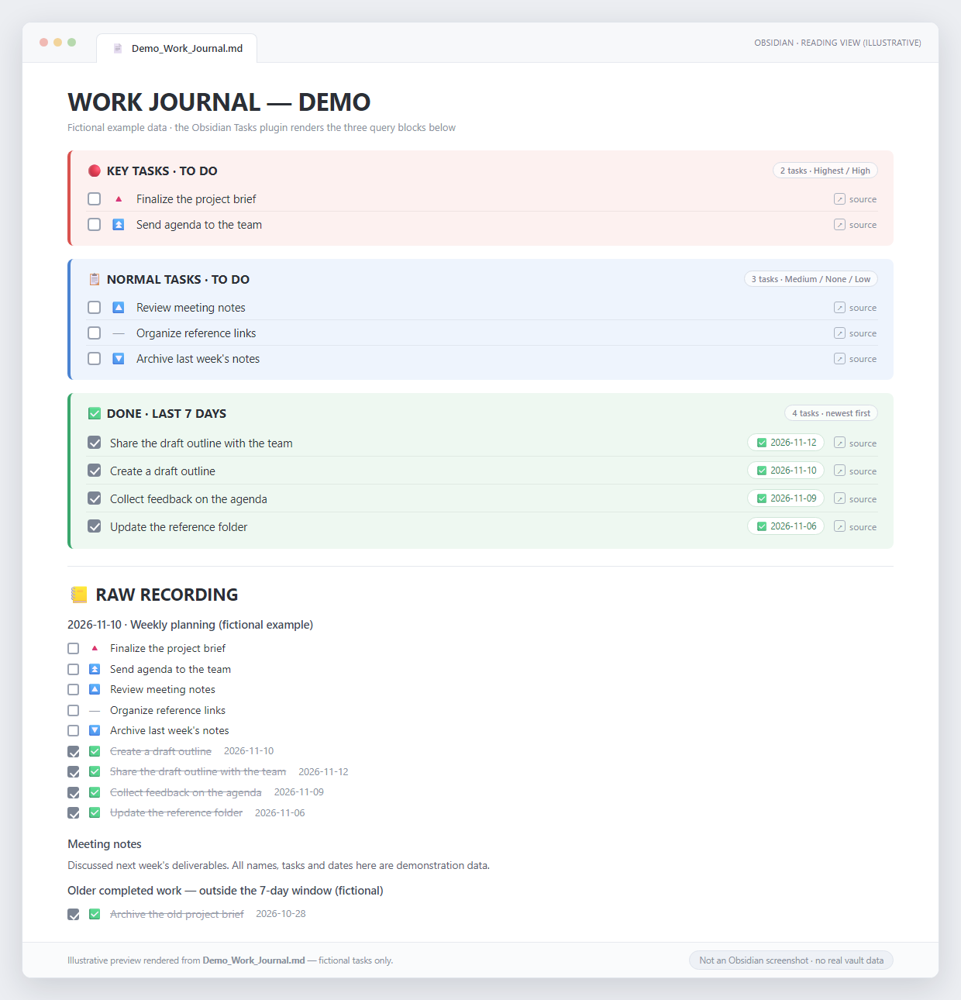
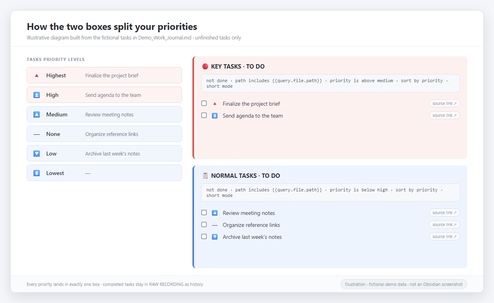

# Obsidian Work Journal Dashboard

**Write once. See your priorities automatically.**

A lightweight, priority-driven work journal for [Obsidian](https://obsidian.md/). It is a single Markdown note that keeps your full work log and meeting notes, and shows your unfinished Highest / High priority tasks at the top — refreshed automatically by the free **Tasks** community plugin.

> **This is an Obsidian template (one `.md` note), not a standalone application and not an Obsidian plugin.**
> The only thing you install is the standard **Tasks** plugin. No Dataview, no JavaScript, no CSS, no build step, no configuration files.



*Illustrative preview rendered from the fictional tasks in `Demo_Work_Journal.md`. Obsidian renders the live, interactive dashboard; GitHub shows only the Markdown source. This image is a static illustration, not a screenshot of a real work journal.*

---

## What's in the box

| File | What it is |
|---|---|
| `Work_Journal_Template.md` | The empty template. Copy this one into your vault. |
| `Demo_Work_Journal.md` | The same template with **fictional example tasks**, so you can see it working. |
| `assets/dashboard-preview.png` | Static illustration of the demo note. |
| `assets/priority-split.png` | Illustration of how priorities map to the two boxes. |
| `LICENSE` | MIT License. |

## Install in three steps

1. **Install Obsidian and the Tasks plugin.** Get [Obsidian](https://obsidian.md/) and open your vault. Go to **Settings → Community plugins → Browse**, search for **Tasks** (by *obsidian-tasks-group*), click **Install**, then **Enable**. If community plugins are off, click **Turn on community plugins** first.
2. **Copy the note into your vault.** Click the green **Code** button on this page → **Download ZIP**, unzip it, and move `Work_Journal_Template.md` anywhere into your vault folder. (Or download the ready-made ZIP from the [v1.0.0 Release](https://github.com/leeliofree/obsidian-work-journal-dashboard/releases/tag/v1.0.0).) Open the note in **Reading view** or **Live Preview**.
3. **Write tasks.** Under `📒 RAW RECORDING`, add lines like `- [ ] Finalize the project brief 🔺`. The two boxes at the top fill in immediately. Tick a checkbox in either box to complete the task in the original note, or click the small link icon to jump back to its source line.

That's it — no plugin settings to change. Tasks just needs its **emoji priority format** enabled (the default) and an empty **global filter**.

> **Just looking?** Copy `Demo_Work_Journal.md` into your vault instead. It contains only fictional example tasks.

## How the dashboard splits your tasks

| Priority | Marker | Appears in |
|---|---|---|
| Highest | 🔺 | 🔴 KEY TASKS · TO DO |
| High | ⏫ | 🔴 KEY TASKS · TO DO |
| Medium | 🔼 | 📋 NORMAL TASKS · TO DO |
| None | — | 📋 NORMAL TASKS · TO DO |
| Low | 🔽 | 📋 NORMAL TASKS · TO DO |
| Lowest | ⏬ | 📋 NORMAL TASKS · TO DO |



*Illustrative diagram built from the same fictional demo tasks.*

Both boxes show **unfinished tasks only**, from **this note only** (`path includes {{query.file.path}}`). The two ranges are `priority is above medium` and `priority is below high` — together they cover every priority exactly once, with no overlap. `short mode` gives you the checkbox and the compact source link; `sort by priority` keeps the most important on top. Completed tasks stay in `📒 RAW RECORDING` as your work history.

The two query blocks (identical in the template and the demo):

```tasks
not done
path includes {{query.file.path}}
priority is above medium
sort by priority
short mode
```

```tasks
not done
path includes {{query.file.path}}
priority is below high
sort by priority
short mode
```

## Good to know

- Tasks must use standard Markdown checkboxes (`- [ ]`). Plain highlighted text is not a task.
- Assign priorities with **Tasks: Create or edit Task**, or by appending the emoji marker (`🔺` / `⏫` / `🔼` / `🔽` / `⏬`).
- This is a **personal, single-note journal**. It does not aggregate tasks from other notes in your vault.
- The dashboard is rendered by Tasks **inside Obsidian**. On GitHub you will see the raw query code, not a live dashboard — that is expected.
- Queries use the Tasks plugin's `priority is above/below` filters. They were validated in a fresh vault with the Tasks plugin; compatibility with every past or future Tasks release is not guaranteed.

## Privacy

Never publish your real work journal or screenshots of it. This repository contains **only fictional sample tasks** — no company, customer, supplier, personal, or credential data, and no screenshots of any real vault.

## License

MIT — see [LICENSE](LICENSE).
